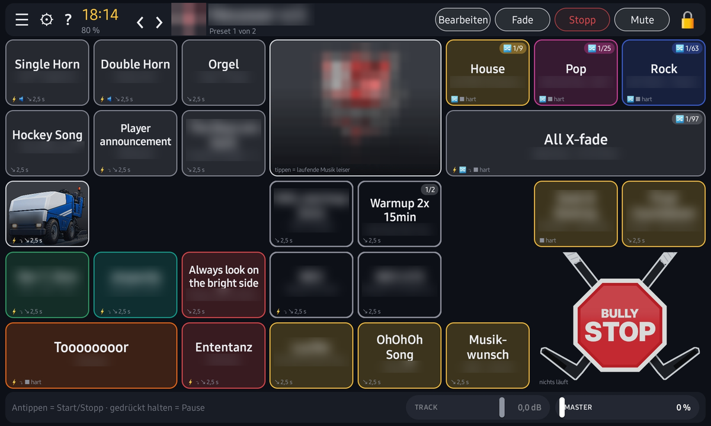

# Soundboard

Mischpult zum Beispiel für Sportveranstaltungen, Feiern oder Gameshows.
Android-App für Tablets im Querformat, entstanden für die Musik bei Eishockey-Heimspielen.

**Aktuelle Version:** 0.14 · [Download v0.14](https://cappy0815.github.io/downloads/Soundboard-v0.14.apk)



## Funktionen

- Frei belegbare Kacheln mit eigenem Bild, einzelne Titel oder ganze Ordner als Playlist
- Pro Titel bzw. Playlist wählbar: harter Stopp oder Fade, eigener Start- und Endpunkt
- Automatische Lautstärke-Angleichung, Fader für Titel (TRACK) und Gesamt (MASTER)
- Taste „Leiser“ für Durchsagen, Vormerken des nächsten Titels während ein Sound läuft
- Sofort-Kacheln (⚡) für Hupe, Hymne oder Zamboni-Musik
- Steuer-Kacheln, Sperre gegen versehentliches Bearbeiten, Spieltag-Reset
- Fernbedienung: Tasten eines Klickers oder Fußschalters anlernen
- Display bleibt an, solange das Ladekabel steckt (optional)
- Update-Prüfung: automatisch (beim Start, höchstens einmal am Tag) oder von Hand

Die App spielt nur eigene Musikdateien vom Gerät ab. Musik ist nicht enthalten, Streaming-Dienste werden nicht unterstützt.

## Installation

Die fertige APK gibt es auf der Projektseite [cappy0815.github.io](https://cappy0815.github.io/#soundboard), dort steht auch die SHA-256-Prüfsumme. Die App steht nicht im Play Store. Beim ersten Installieren fragt Android, ob Installationen aus dieser Quelle (z. B. dem Browser) erlaubt werden sollen.

Voraussetzung: Android 8.0 oder neuer.

Neue Versionen lassen sich einfach über die alte installieren. Kacheln, Presets und Einstellungen bleiben erhalten.

## Updates

In den Einstellungen (⚙) unter **Updates**: „Automatisch nach Updates suchen“ schaut beim Start nach, höchstens einmal am Tag; „Jetzt prüfen“ sofort (auch in der Hilfe unter **Über**). Gibt es eine neue Version, steht oben in der Kopfleiste **⬆ Update**. Ein Tipp öffnet den Download der APK im Browser. Installiert wird nichts automatisch.

Geprüft wird die Versionsdatei [`soundboard.json`](https://cappy0815.github.io/downloads/soundboard.json) auf der Projektseite. Ist sie nicht erreichbar, prüft die App das neueste Release dieses Repositorys.

Das ist die einzige Internetverbindung der App. Daten aus der App werden dabei nicht gesendet.

## Selbst bauen

Gebaut wird ohne Gradle und ohne Android Studio, unter Linux:

```bash
./setup-sdk.sh                 # Build-Werkzeuge holen (aapt2, android.jar, dx)
python3 tools-icon.py .        # App-Icons erzeugen (braucht Pillow)
export SB_KEYSTORE=/pfad/zu/eigenem.jks SB_STOREPASS=... SB_ALIAS=...
./build.sh                     # ergibt build/Soundboard-v0.14.apk
```

Der Signierschlüssel ist nicht im Repo. Mit einem eigenen Schlüssel gebaute APKs lassen sich nicht über die offizielle Version installieren.

## Veröffentlichen (neue Version)

1. Version in `build.sh` (`VERSION_NAME`, `VERSION_CODE` +1) und Changelog in `Dialogs.java` pflegen, bauen
2. APK nach `cappy0815.github.io/downloads/` legen
3. Dort `soundboard.json` anpassen (`version`, `download`, `sha256`)
4. `index.html` der Projektseite (Versions-Chip, Download-Link, SHA-256) und dieses README aktualisieren

## Hinweis

Privates Projekt, kostenlos und ohne Gewähr. Kein Support.

Gebaut von Justus Jonas & MCHLNWK · [cappy0815.github.io](https://cappy0815.github.io)
