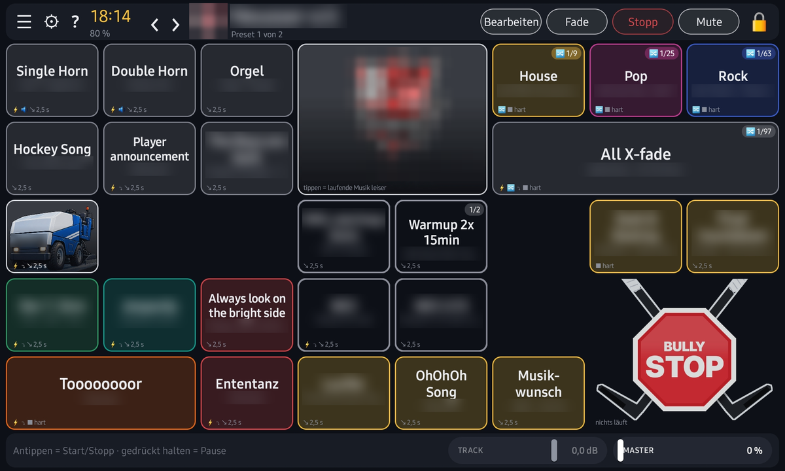

# Soundboard

Mischpult zum Beispiel für Sportveranstaltungen, Feiern oder Gameshows.
Android-App für Tablets im Querformat, entstanden für die Musik bei Eishockey-Heimspielen.

**Aktuelle Version:** 0.13.1



## Funktionen

- Frei belegbare Kacheln mit eigenem Bild, einzelne Titel oder ganze Ordner als Playlist
- Pro Titel bzw. Playlist wählbar: harter Stopp oder Fade, eigener Start- und Endpunkt
- Automatische Lautstärke-Angleichung, Fader für Titel (TRACK) und Gesamt (MASTER)
- Taste „Leiser“ für Durchsagen, Vormerken des nächsten Titels während ein Sound läuft
- Sofort-Kacheln (⚡) für Hupe, Hymne oder Zamboni-Musik
- Steuer-Kacheln, Sperre gegen versehentliches Bearbeiten, Spieltag-Reset
- Fernbedienung: Tasten eines Klickers oder Fußschalters anlernen
- Display bleibt an, solange das Ladekabel steckt (optional)

Die App spielt nur eigene Musikdateien vom Gerät ab. Musik ist nicht enthalten, Streaming-Dienste werden nicht unterstützt.

## Installation

Die fertige APK gibt es unter [Releases](../../releases). Die App steht nicht im Play Store. Beim ersten Installieren fragt Android, ob Installationen aus dieser Quelle erlaubt werden sollen.

Voraussetzung: Android 8.0 oder neuer.

## Selbst bauen

Gebaut wird ohne Gradle und ohne Android Studio, unter Linux:

```bash
./setup-sdk.sh                 # Build-Werkzeuge holen (aapt2, android.jar, dx)
python3 tools-icon.py .        # App-Icons erzeugen (braucht Pillow)
export SB_KEYSTORE=/pfad/zu/eigenem.jks SB_STOREPASS=... SB_ALIAS=...
./build.sh                     # ergibt build/Soundboard-v0.13.1.apk
```

Der Signierschlüssel ist nicht im Repo. Mit einem eigenen Schlüssel gebaute APKs lassen sich nicht über die offizielle Version installieren.

## Hinweis

Privates Projekt, kostenlos und ohne Gewähr. Kein Support.

Gebaut von Justus Jonas & MCHLNWK · [cappy0815.github.io](https://cappy0815.github.io)
